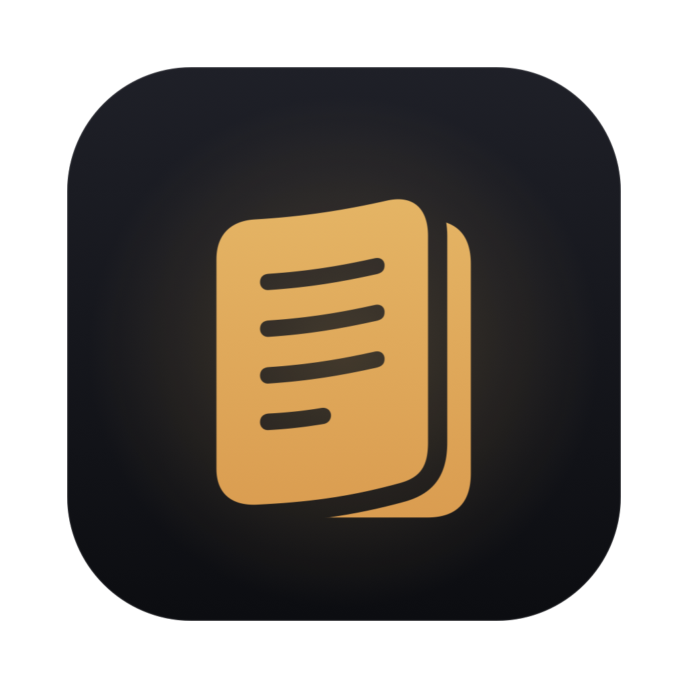

<p align="center">
  
</p>

<h1 align="center">Storyteller</h1>

<p align="center">A native macOS interactive fiction app, in the spirit of AI Dungeon, running entirely on your own machine with <a href="https://ollama.com">Ollama</a>.</p>

## Features

- **Play in turns**: *Do* ("open the door" → "You open the door."), *Say*, *Story* (write the narration yourself), and *Guide* (tell the AI what should happen next).
- **Multiple stories at once**, each with its own setup. Hold <kbd>⌘</kbd> to see a shortcut key for each story.
- **Story setup**: AI instructions (system prompt), plot essentials, a running summary, and an author's note.
- **Story cards** for characters, locations, factions, items and lore, which are sent to the AI only when they're mentioned.
- **Context ring** showing how full the model's context is, with a breakdown.
- **Story memory sizes** (4K–32K) with RAM estimates based on the model's architecture.
- Retry, undo/redo, inline editing, text zoom, and auto-saved drafts.
- Stories are plain JSON files in a folder you choose.

## Requirements

- macOS 15 or later (Apple silicon or Intel)
- [Ollama](https://ollama.com) running locally, with a model pulled. The default is Hermes 3 3B:

  ```bash
  ollama pull hermes3:3b
  ```

  You can pick any installed model per story in **Story Setup → Settings**.

## Install

Download the latest `Storyteller-x.y.z.dmg` from [Releases](../../releases), open it, and drag **Storyteller** to Applications. The app is signed and notarized.

## Where stories are saved

By default stories are saved in `~/Library/Application Support/Storyteller/Stories`, one JSON file per story. To use a different folder, click the folder icon at the bottom of the sidebar and choose **Change Folder…**.

To use an Ollama server other than `http://127.0.0.1:11434`, set the `OLLAMA_URL` environment variable.

## Build from source

You need Xcode 16 or later.

```bash
cd storyteller-mac
./build.sh          # builds Storyteller.app for this Mac
```

`release.sh` builds a universal app, signs it with a Developer ID, notarizes it, and packages it as a DMG. It needs your own signing identity and notarytool profile:

```bash
SIGN_IDENTITY="Developer ID Application: …" NOTARY_PROFILE=<profile> ./release.sh 1.0.0
```

The app icon is drawn by `tools/make-icon.swift`.
